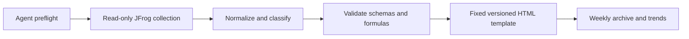

<div align="center">

# JFrog Platform Report Skill

_A weekly operating record for JFrog Platform value, risk and action._

[](SKILL.md)
[](https://github.com/liquid-jedi/jfrog-platform-report-skills/releases/tag/v1.3.2)
[](#requirements)
[](LICENSE)

</div>


[**View live dashboard**](https://liquid-jedi.github.io/jfrog-platform-report-skills/examples/report.html) &nbsp;|&nbsp;
[**Executive PDF**](docs/examples/jfrog-platform-report-executive.pdf) &nbsp;|&nbsp;
[**Full PDF**](docs/examples/jfrog-platform-report-full.pdf) &nbsp;|&nbsp;
[**Read the report guide**](https://liquid-jedi.github.io/jfrog-platform-report-skills/report-guide.html)

The skill collects fresh, read-only evidence from the capabilities available in a
customer's JFrog environment and turns it into a self-contained weekly HTML report.
Every metric is classified as **observed**, **derived**, **projected**, **benchmark**,
or **unavailable**. Missing evidence is never silently converted to zero.

> This is not an official JFrog publication. Reports are generated using JFrog
> Platform Skills from evidence visible to the configured customer identity.

## Why this report exists

JFrog Platform data is operationally rich but distributed across Artifactory, Xray,
Curation, JAS, Runtime, AI Catalog and Access. Product dashboards are designed for
day-to-day operation; leadership reviews need a durable, time-bounded record that
connects activity, posture, trend and action.

This skill provides that operating rhythm:

- **A weekly evidence archive** that preserves what happened during the period.
- **A shared leadership view** across platform adoption, supply-chain risk and AI governance.
- **Week-over-week trends** built only from validated reports with comparable evidence.
- **Prioritized recommendations** with a clear 7-day or 30-day decision horizon.
- **Explicit evidence quality** so observed results, projections, benchmarks and gaps cannot be confused.
- **A monthly executive roll-up** built from the validated weekly record rather than reconstructed later.

## Quick start

### APM: reproducible project installation

The following commands are for **macOS, Linux and Windows WSL**.

Create a working directory:

```bash
mkdir -p ~/jfrog-platform-reporting
```

Enter the directory:

```bash
cd ~/jfrog-platform-reporting
```

Initialize APM:

```bash
apm init -y
```

Install the pinned release:

```bash
apm install liquid-jedi/jfrog-platform-report-skills#v1.3.2 \
  --target claude,cursor,codex,gemini
```

### Global Agent Skills installation

For **macOS, Linux and Windows WSL** with Node.js available:

```bash
npx skills add git@github.com:liquid-jedi/jfrog-platform-report-skills.git \
  -g --skill jfrog-platform-report
```

Then ask your agent:

```text
Generate weekly platform report
```

The skill discovers the default JFrog CLI instance, resolves the last completed ISO
week, presents one compact confirmation, collects fresh evidence and saves the report
under the configured per-instance archive.

[Installation details](docs/INSTALL.md) · [Troubleshooting](docs/TROUBLESHOOTING.md)

## Requirements

| Requirement | Purpose |
|---|---|
| macOS, Linux or Windows WSL | Supported execution environments; WSL is recommended over native Windows |
| Python 3.11 or later | Runs deterministic collectors, normalization and rendering |
| JFrog CLI | Provides authenticated, read-only access to the selected JFrog instance |
| Configured JFrog server | The skill discovers the default or sole configured server |
| Base JFrog Agent Skill | Provides current CLI and API operating guidance |

## Inputs and decisions

The short prompt does not hide configuration. The skill resolves safe defaults and asks
only when a choice is required.

| Input | Default behavior | When the user is asked |
|---|---|---|
| **JFrog instance** | Uses the JFrog CLI default, or the sole configured instance | When multiple instances exist and none is unambiguously selected |
| **Report period** | Last completed ISO week in the report timezone | When the user requests another week, a partial current week or a monthly roll-up |
| **Report sections** | Full report | The user may choose Executive or Custom; Custom exposes section selection |
| **Timezone** | Local IANA timezone, otherwise UTC | When detection is unavailable or the user wants another reporting timezone |
| **Output location** | Saved per-instance location; first-run recommendation is `~/jfrog-platform-reports` | On first use, or when no location has been configured |
| **Economic context** | External Forrester TEI benchmark only | Customer projections require an approved profile with currency, costs, baselines, coverage and realization assumptions |
| **Missed weekly coverage** | Audited after every successful report | Recoverable missing weeks from the previous calendar month are offered for explicit approval |

## One report, modular views

| Component | Leadership question |
|---|---|
| **Executive overview** | What changed, what matters and what needs attention? |
| **Trends** | Is adoption, value or risk improving week over week? |
| **Curation** | What was evaluated, allowed or stopped before consumption? |
| **Artifactory** | What is stored, how is the repository estate distributed and how is traffic changing? |
| **Xray** | What security and license findings were created during the period? |
| **AI security** | Which models, MCP servers, skills and plugins are governed, scanned or risky? |
| **Access & OIDC** | Which tokens need rotation and where is workload identity trusted? |
| **JAS & Runtime** | Which findings are applicable, exploitable or present in production? |
| **Economic context** | What external benchmark or approved customer scenario is defensible? |
| **Recommendations** | Which actions need an owner in the next 7 or 30 days? |

Each tile has a documented interpretation, source boundary, evidence classification
and decision use. See the [report guide](https://liquid-jedi.github.io/jfrog-platform-report-skills/report-guide.html) for the complete tile
catalog and the [synthetic live example](https://liquid-jedi.github.io/jfrog-platform-report-skills/examples/report.html)
for a working report with trends, anonymized identities, fictional repositories and
recommendations.

Artifactory-only, Artifactory + Xray and full-platform environments are supported.
Optional products are feature-detected; an unavailable capability does not break the
report or masquerade as a genuine zero.

## Deterministic by design



- The agent orchestrates; scripts collect, normalize, calculate and render.
- Raw responses are checksum-manifested with source, period and collection time.
- Incomplete pagination fails the run instead of publishing partial totals.
- Current posture and period activity remain separate.
- Prior reports are used only after current collection, and only for labelled trends.
- A failed rerun never replaces the last validated report.

## Truthful economics

Without an approved per-instance economic profile, the bundled Forrester TEI composite
is shown strictly as external **benchmark** context, not customer ROI. An explicitly
approved profile can enable deterministic conservative, expected and optimistic
customer projections with configurable currency, costs, coverage and realization.

Each report preserves the exact profile snapshot used. Duplicate benefits, invalid
assumptions and missing FX evidence are rejected rather than estimated by the agent.

[Economic profile contract](references/economic-profiles.md)

## Evidence and safety

| Guarantee | Behavior |
|---|---|
| Read-only by default | Publication or platform mutation requires explicit authorization |
| No invented values | Missing, forbidden, unlicensed, partial and zero remain distinct |
| No backdating | Current AI, Artifactory or access posture is never represented as historical activity |
| No double counting | Every projected benefit has one unique benefit key |
| Privacy-aware access reporting | Token secrets, IDs and scopes are never written to the report |
| Portable output | The report is a self-contained HTML file with its font and assets embedded |

## Output archive

```text
<report-root>/<instance>/weekly/<week-ending>/
├── report.html
├── data.json
├── latest.json
└── runs/<UTC-run-id>/
    ├── report.html
    ├── data.json
    ├── evidence.json
    ├── economic-profile.snapshot.json
    ├── collection-diagnostics.json
    └── raw/
```

The default promoted report is:

```text
~/jfrog-platform-reports/<instance>/weekly/<week-ending>/report.html
```

## Custom rendering

Section selection changes presentation, not collection or calculation semantics.

```bash
python3 scripts/list_report_sections.py
```

```bash
python3 scripts/render_report.py \
  --data /path/to/data.json \
  --template assets/dashboard.html \
  --output /path/to/report.html \
  --modules executive,trend,artifactory,ai-security,recommendations,evidence
```

<details>
<summary><strong>Development and verification</strong></summary>

The fixture-based suite protects reporting semantics: financial formulas, evidence
classification, missing permissions, unlicensed products, pagination failure,
same-day reruns, portability and HTML generation. It intentionally runs without a
production JFrog environment so contributors can verify changes without customer data.

Clone the repository:

```bash
git clone https://github.com/liquid-jedi/jfrog-platform-report-skills.git
```

Enter the repository:

```bash
cd jfrog-platform-report-skills
```

Run verification:

```bash
python3 -m unittest discover -s tests -v
```

</details>

| Resource | Purpose |
|---|---|
| [Skill workflow](SKILL.md) | Agent orchestration, safety and reporting contract |
| [Architecture](references/architecture.md) | Deterministic workflow and extension boundaries |
| [Data-source matrix](references/data-source-matrix.md) | Supported evidence and known product-data gaps |
| [Metric contract](references/metric-contract.md) | Classification, formulas and financial rules |
| [Product modules](references/product-modules.md) | Module ownership and interpretation |
| [Report guide](docs/report-guide.html) | Styled guide to tile meanings, classifications, colors and decision use |
| [Synthetic dashboard](docs/examples/report.html) | Interactive full-platform example with fictional data |
| [Executive PDF](docs/examples/jfrog-platform-report-executive.pdf) | Concise printable leadership example |
| [Full PDF](docs/examples/jfrog-platform-report-full.pdf) | Complete printable example across all modules |
| [Installation](docs/INSTALL.md) | APM, global installation and updates |
| [Troubleshooting](docs/TROUBLESHOOTING.md) | Common installation and collection issues |
