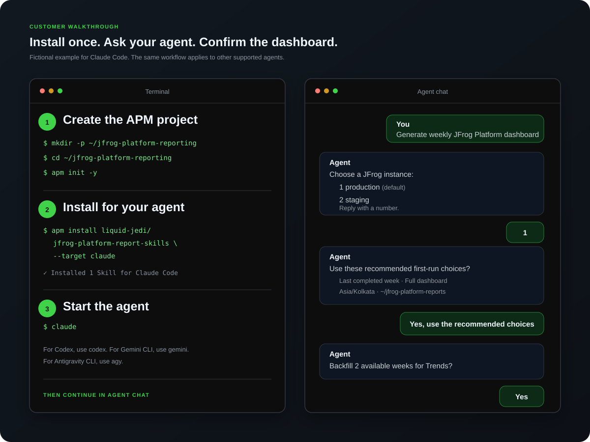
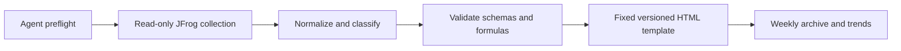

<div align="center">

# JFrog Platform Dashboard Skill

_Generate a weekly JFrog Platform dashboard with your AI agent._

[](SKILL.md)
[](https://github.com/liquid-jedi/jfrog-platform-report-skills/releases/tag/v1.6.4)
[](#requirements)
[](LICENSE)

</div>



[**View live dashboard**](https://liquid-jedi.github.io/jfrog-platform-report-skills/examples/report.html) &nbsp;|&nbsp;
[**Executive PDF**](docs/examples/jfrog-platform-report-executive.pdf) &nbsp;|&nbsp;
[**Full PDF**](docs/examples/jfrog-platform-report-full.pdf) &nbsp;|&nbsp;
[**Read the report guide**](https://liquid-jedi.github.io/jfrog-platform-report-skills/report-guide.html)

Built for teams that need a repeatable view of platform activity, risk, governance and
change over time, without manually assembling data from multiple product areas. The
Skill produces a self-contained weekly HTML dashboard with optional PDF exports. Every
metric is classified as **observed**, **derived**, **projected**, **benchmark**, or
**unavailable**. Missing data is never silently converted to zero.

> This is not an official JFrog publication. Dashboards are generated using JFrog
> Platform Skills and data available to the configured customer identity.

## Why it exists

### One week. One view. Fewer loose ends.

Platform activity is spread across products, APIs and point-in-time screens. The JFrog
Platform Dashboard Skill captures what is available for the week and packages it into
a view that can be reviewed, compared and shared.

- **Run it with your agent.** Choose an instance, reporting period and sections. The
  Skill handles the collection and dashboard workflow.
- **Keep the weeks comparable.** Each successful run creates a dated snapshot, giving
  future dashboards a reliable basis for trends.
- **See what needs attention.** Available platform signals are grouped into activity,
  risk, governance and follow-up actions.

## Install and run

### 1. Install prerequisites on macOS

Homebrew provides the simplest supported setup:

```bash
brew install python git jfrog-cli apm
```

Verify the tools and configure at least one JFrog instance:

```bash
python3 --version
git --version
jf --version
apm --version
jf config add
jf config show
```

Python 3.11 or later is required. For live reporting, the agent also needs the base
JFrog integration guidance. The recommended installation is the official JFrog plugin,
which includes the base JFrog Skill and supporting JFrog agent integrations. For Codex:

```bash
codex plugin marketplace add jfrog/codex-plugin
codex plugin add jfrog@codex-plugin
```

For Claude Code, start `claude`, open the plugin manager, and install
`jfrog@claude-plugins-official`. Follow the host-specific JFrog plugin instructions for
other supported agents.

### 2. Install prerequisites in Windows WSL2

Run these commands inside the WSL terminal, not PowerShell:

```bash
sudo apt update
sudo apt install -y git python3 python3-venv curl
curl -fL https://install-cli.jfrog.io | sh
curl -sSL https://aka.ms/apm-unix | sh
exec "$SHELL" -l
```

Then verify and configure JFrog:

```bash
python3 --version
git --version
jf --version
apm --version
jf config add
jf config show
```

Install the JFrog plugin for the agent that runs inside WSL. The Dashboard Skill uses
the base JFrog Skill included in that plugin; the JFrog CLI remains the authenticated
transport used by the deterministic collectors.

### 3. Install the Dashboard Skill with APM

The same commands work on macOS and WSL:

```bash
mkdir -p ~/jfrog-platform-reporting
cd ~/jfrog-platform-reporting
apm init -y
apm install liquid-jedi/jfrog-platform-report-skills \
  --target claude
apm deps list
apm audit
```

Replace `claude` with the agent where APM should deploy the Skill. Supported targets
include `claude`, `codex`, `cursor`, `gemini` and `antigravity`. Persist the selected
targets in `apm.yml` for upgrades:

```yaml
targets:
  - claude
  - codex
  - cursor
  - gemini
  - antigravity
```

### 4. Start the agent and invoke the skill

Launch one installed agent from the APM project directory:

```bash
claude
```

or:

```bash
codex
```

For Cursor, open the folder in Cursor and start Agent chat. Run `gemini` for Gemini
CLI or `agy` for Antigravity CLI. Then enter this prompt in the agent chat:

```text
Generate weekly JFrog Platform dashboard
```

### 5. First-run walkthrough

The skill asks one decision at a time. Example instance names below are generic:

1. **JFrog instance:** every server from `jf config show` is listed. Choose a number,
   such as `1` for `production` or `2` for `staging`. Recommended answer: the number
   for the production instance you intend to report on.
2. **Reporting period:** accept the last completed Monday-to-Sunday week, or request a
   different completed week. A current week is clearly marked partial. Recommended
   answer: `Last completed week`.
3. **Report scope:** choose `Full`, `Executive`, or `Custom`. Custom lets you select
   individual product sections and the optional Forrester benchmark. Recommended
   first-run answer: `Full`.
4. **Timezone:** accept the detected IANA timezone or enter one such as
   `America/New_York` or `Asia/Singapore`. Recommended answer: accept the detected
   timezone when it matches the reporting team.
5. **Output location:** accept `~/jfrog-platform-reports` or enter another folder.
   Recommended answer: accept the default unless the organization has a shared path.
6. **First-run trend history:** when the selected instance has no validated weekly
   archives in the current calendar month, the skill lists earlier completed weeks
   that are still eligible for collection and asks whether to backfill them. Recommended
   answer: `Yes` when week-over-week trends are required. Backfill always runs one week
   at a time and never includes a future, partial or retention-expired week.
7. **Confirmation:** review the instance, period, scope, timezone, destination and any
   approved backfill, then answer `Y` to begin read-only collection.



The example uses fictional instance names, dates and paths. Actual choices reflect the
JFrog CLI configuration and dashboard history available on the customer's machine.

### Alternative global Skills installation

For hosts that use the Skills CLI, install globally with Node.js available:

```bash
npx skills add git@github.com:liquid-jedi/jfrog-platform-report-skills.git \
  -g --skill jfrog-platform-report
```

This is an alternative installation method. Start the agent and use the same invocation
prompt described above.

### Upgrade an existing APM installation

Run one command from the directory containing `apm.yml`:

```bash
apm update liquid-jedi/jfrog-platform-report-skills \
  --target claude
```

Replace `claude` with another installed target, or use a comma-separated list such as
`--target claude,codex,cursor,gemini`. If targets are already declared at the top level
of `apm.yml`, the `--target` option can be omitted.

The unpinned manifest entry follows the repository's production-ready default branch while
`apm.lock.yaml` records the exact resolved commit. Existing installations that still
contain a `#v...` ref need the one-time migration in
[Troubleshooting](docs/TROUBLESHOOTING.md#an-existing-installation-is-pinned-to-an-older-tag).

Public examples and upgrade guidance use only generic instance names. The GitHub owner
shown in the initial installation command is a package coordinate, not a JFrog server.

[Installation details](docs/INSTALL.md) · [Troubleshooting](docs/TROUBLESHOOTING.md)

## Requirements

| Requirement | Purpose |
|---|---|
| macOS, Linux or Windows WSL | Supported execution environments; WSL is recommended over native Windows |
| Python 3.11 or later | Runs deterministic collectors, normalization and rendering |
| Git and APM | Resolves and pins the Skill package for reproducible installation |
| JFrog CLI | Provides authenticated, read-only access to the selected JFrog instance |
| One or more configured JFrog servers | First use lists every `jf config show` instance for explicit selection |
| Official JFrog plugin | Recommended installation of the required base JFrog Skill and supporting agent integrations |
| Claude Code, Codex, Cursor, Gemini CLI or Google Antigravity | Agent host used to invoke and orchestrate the Skill |

### Optional: JFrog Boost

[JFrog Boost](https://github.com/jfrog/boost) is optional and is not required to collect
or render a report. It can reduce repetitive terminal and tool output read by supported
coding agents, which may lower context usage during large collections. It does not make
JFrog APIs respond faster or replace pagination, validation, the JFrog plugin, or the
JFrog CLI. Boost is currently preview software; review its preview terms and telemetry
disclosure before installing it.

On macOS, Linux or WSL:

```bash
curl -fsSL https://boost.jfrog.com/install.sh | bash
boost init --dry-run
boost init
```

## Inputs and decisions

The short prompt does not hide configuration. The skill resolves safe defaults and asks
only when a choice is required.

| Input | Default behavior | When the user is asked |
|---|---|---|
| **JFrog instance** | Lists every `jf config show` instance and marks the CLI default as recommended | On first use, before the period and report choices; later runs allow changing the saved choice |
| **Report period** | Last completed ISO week in the report timezone | When the user requests another week, a partial current week or a monthly roll-up |
| **Report sections** | Full report | The user may choose Executive or Custom; Custom exposes section selection |
| **Timezone** | Local IANA timezone, otherwise UTC | When detection is unavailable or the user wants another reporting timezone |
| **Output location** | Saved per-instance location; first-run recommendation is `~/jfrog-platform-reports` | On first use, or when no location has been configured |
| **External benchmark** | Optional Forrester TEI composite, clearly labelled as external research | The user can include or exclude this section; no customer finance questionnaire is required |
| **Missed weekly coverage** | Audited after every successful report | Recoverable missing weeks from the previous calendar month are offered for explicit approval |

## One report, modular views

| Component | Leadership question |
|---|---|
| **Executive overview** | What changed, what matters and what needs attention? |
| **Trends** | Is adoption, value or risk improving week over week? |
| **Curation** | What was evaluated, allowed or stopped before consumption? |
| **Artifactory** | What is stored, how is the repository estate distributed and how is traffic changing? |
| **Xray** | What security and license findings were created during the period? |
| **AppTrust** | Which critical applications lack ownership, and what is the release-governance posture? |
| **AI security** | Which models, MCP servers, skills and plugins are governed, scanned or risky? |
| **Access & OIDC** | Which tokens need rotation and where is workload identity trusted? |
| **JAS & Runtime** | Which findings are applicable, exploitable or present in production? |
| **External Forrester benchmark** | What did the published composite study report, separate from this customer's evidence? |
| **Recommendations** | Which actions need an owner in the next 7 or 30 days? |

Each tile has a documented interpretation, source boundary, evidence classification
and decision use. See the [report guide](https://liquid-jedi.github.io/jfrog-platform-report-skills/report-guide.html) for the complete tile
catalog and the [synthetic live example](https://liquid-jedi.github.io/jfrog-platform-report-skills/examples/report.html)
for a working report with trends, anonymized identities, fictional repositories and
recommendations.

Artifactory-only, Artifactory + Xray and full-platform environments are supported.
Optional products are feature-detected; an unavailable capability does not break the
report or masquerade as a genuine zero.

## Deterministic by design



- The agent orchestrates; scripts collect, normalize, calculate and render.
- Raw responses are checksum-manifested with source, period and collection time.
- Incomplete pagination fails the run instead of publishing partial totals.
- Current posture and period activity remain separate.
- Prior reports are used only after current collection, and only for labelled trends.
- A failed rerun never replaces the last validated report.

## External benchmark, kept separate

The optional final section presents the bundled Forrester TEI composite strictly as
external **benchmark** context. It is not customer ROI, is not derived from the weekly
report, and is never presented as realized savings. The normal workflow does not ask a
platform administrator for finance-owned cost, baseline or realization assumptions.

## Evidence and safety

| Guarantee | Behavior |
|---|---|
| Read-only by default | Publication or platform mutation requires explicit authorization |
| No invented values | Missing, forbidden, unlicensed, partial and zero remain distinct |
| No backdating | Current AI, Artifactory or access posture is never represented as historical activity |
| No double counting | Every projected benefit has one unique benefit key |
| Privacy-aware access reporting | Token secrets, IDs and scopes are never written to the report |
| Portable output | The report is a self-contained HTML file with its font and assets embedded |

## Output archive

```text
<report-root>/<instance>/weekly/<week-ending>/
├── report.html
├── executive-report.pdf
├── full-report.pdf
├── data.json
├── latest.json
└── runs/<UTC-run-id>/
    ├── report.html
    ├── data.json
    ├── evidence.json
    ├── economic-profile.snapshot.json
    ├── collection-diagnostics.json
    └── raw/
```

The default promoted report is:

```text
~/jfrog-platform-reports/<instance>/weekly/<week-ending>/report.html
```

## Custom rendering

Section selection changes presentation, not collection or calculation semantics.

```bash
python3 scripts/list_report_sections.py
```

```bash
python3 scripts/render_report.py \
  --data /path/to/data.json \
  --template assets/dashboard.html \
  --output /path/to/report.html \
  --modules executive,trend,artifactory,ai-security,recommendations,evidence
```

Export polished A4 reports from the validated HTML:

```bash
python3 scripts/export_report_pdfs.py \
  --html /path/to/report.html \
  --output-dir /path/to/report-folder \
  --mode both
```

<details>
<summary><strong>Development and verification</strong></summary>

The fixture-based suite protects reporting semantics: financial formulas, evidence
classification, missing permissions, unlicensed products, pagination failure,
same-day reruns, portability and HTML generation. It intentionally runs without a
production JFrog environment so contributors can verify changes without customer data.

Clone the repository:

```bash
git clone https://github.com/liquid-jedi/jfrog-platform-report-skills.git
```

Enter the repository:

```bash
cd jfrog-platform-report-skills
```

Run verification:

```bash
python3 -m unittest discover -s tests -v
```

</details>

| Resource | Purpose |
|---|---|
| [Skill workflow](SKILL.md) | Agent orchestration, safety and reporting contract |
| [Architecture](references/architecture.md) | Deterministic workflow and extension boundaries |
| [Data-source matrix](references/data-source-matrix.md) | Supported evidence and known product-data gaps |
| [Metric contract](references/metric-contract.md) | Classification, formulas and financial rules |
| [Product modules](references/product-modules.md) | Module ownership and interpretation |
| [Report guide](docs/report-guide.html) | Styled guide to tile meanings, classifications, colors and decision use |
| [Synthetic dashboard](docs/examples/report.html) | Interactive full-platform example with fictional data |
| [Executive PDF](docs/examples/jfrog-platform-report-executive.pdf) | Concise printable leadership example |
| [Full PDF](docs/examples/jfrog-platform-report-full.pdf) | Complete printable example across all modules |
| [Installation](docs/INSTALL.md) | APM, global installation and updates |
| [Troubleshooting](docs/TROUBLESHOOTING.md) | Common installation and collection issues |
