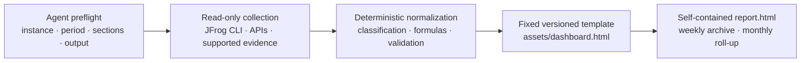

# JFrog Platform Report Skill

> **Evidence-backed platform value and risk reporting for JFrog** — one portable
> Agent Skill, one fixed HTML template, and deterministic collection across the
> capabilities available in each customer environment.

[](SKILL.md)
[](apm.yml)
[](#development-and-testing)
[](LICENSE)

The skill generates a modular **JFrog Platform Value & Risk Report** for platform,
security and technology leadership. It separates period activity from current posture,
marks every metric as observed, derived, projected, benchmark or unavailable, and
never turns missing evidence into zero.

The agent does not invent report HTML or calculate business metrics in free-form
reasoning. Deterministic Python collectors and calculators produce structured JSON,
which is injected into the versioned template at `assets/dashboard.html`.

## What the report covers

Sections are independently selectable. The skill still collects and validates the
complete available evidence model so a focused view never changes totals or formulas.

| Section | What it helps answer |
|---|---|
| Executive overview | What changed, what matters, and what needs leadership attention? |
| Trends | Is value, adoption or risk improving week over week? |
| Curation | What was evaluated, approved or blocked, and who used the control? |
| Artifactory | What is stored, how repositories are distributed, and how traffic changes? |
| Xray | What security and license findings were created during the period? |
| AI security | What models, MCP servers, skills and plugins are governed and how were they classified? |
| Access, tokens & OIDC | Which credentials need rotation and where is workload identity used? |
| JFrog Advanced Security | Which findings are applicable, fixable or exploitable? |
| Runtime security | Which risks are present in running production images? |
| Economic context | What value scenarios are supportable from explicit customer assumptions? |

Economic context is useful without inventing customer ROI. With no approved
per-instance economic profile, the report shows the bundled Forrester TEI composite
only as external `benchmark` evidence. An explicitly approved profile can enable
deterministic conservative, expected and optimistic customer projections. Profiles
are stored per instance and snapshotted with every report; see
[`references/economic-profiles.md`](references/economic-profiles.md).
| Recommendations | Which actions should be owned in the next 7 or 30 days? |
| Methodology & evidence | Where did each result come from and what remains unavailable? |

Optional capabilities are feature-detected. An Artifactory-only customer still gets a
valid report; missing Xray, Curation, JAS, Runtime or AI Catalog evidence does not break
generation and is never silently represented as zero.

## How it works



## Prerequisites

| Requirement | Check | Notes |
|---|---|---|
| Python 3.11+ | `python3 --version` | Standard-library scripts; no Python package installation required |
| JFrog CLI | `jf --version` | Required for live collection |
| Configured JFrog server | `jf config show` | The skill discovers the default or sole configured instance |
| Base JFrog Agent Skill | Agent-specific skill list | Provides current JFrog CLI and API operating guidance |
| Browser | Open `report.html` | Only needed to view or print the generated report |

macOS and Linux/WSL are supported. Native Windows is best-effort; WSL is recommended
so the same tested code path is used without a second OS-specific implementation.

## Install

The canonical artifact is this repository's Agent Skills folder. APM and `npx skills`
are installation adapters; they do not contain separate report logic.

### Option A — APM project install

Best for teams that want a reproducible project-local installation and lockfile.

```bash
# Install APM using an official method from https://microsoft.github.io/apm/
mkdir -p ~/jfrog-platform-reporting
cd ~/jfrog-platform-reporting
apm init -y

apm install liquid-jedi/jfrog-platform-report-skills#v1.1.0 \
  --target claude,cursor,codex,gemini
```

Verify:

```bash
find .agents/skills/jfrog-platform-report-skills -maxdepth 2 -type f | sort
grep '^name: jfrog-platform-report$' \
  .agents/skills/jfrog-platform-report-skills/SKILL.md
```

### Option B — global Agent Skills install

Best for an individual who wants the skill available from any folder.

```bash
npx skills add git@github.com:liquid-jedi/jfrog-platform-report-skills.git \
  -g --skill jfrog-platform-report
```

Verify:

```bash
npx skills list -g | grep jfrog-platform-report
```

### Option C — local clone for development

```bash
git clone https://github.com/liquid-jedi/jfrog-platform-report-skills.git
cd jfrog-platform-report-skills
python3 -m unittest discover -s tests -v
```

Detailed installation and troubleshooting are in [docs/INSTALL.md](docs/INSTALL.md)
and [docs/TROUBLESHOOTING.md](docs/TROUBLESHOOTING.md).

## Run a report

The shortest invocation is:

```text
Generate weekly platform report
```

The skill then:

1. Discovers the configured JFrog instance, preferring the JFrog CLI default.
2. Resolves the last completed ISO week using the machine's local IANA timezone.
3. Shows one compact confirmation with the instance, period, Full report profile and
   default output location. Reply `Proceed` to accept everything.
4. Uses native selectable controls when the agent host supports them. `Custom` opens a
   multi-select/checkbox list; hosts without interactive controls use a numbered text
   fallback.
5. Collects fresh read-only evidence, validates it, renders the fixed template and
   checks the previous month for missed weekly coverage.

Other examples:

```text
Generate weekly platform report for solenglatest.
Generate this week's platform report with Artifactory, Xray and AI security.
Generate the week ending 2026-11-15 platform report.
Generate the monthly executive platform report for October 2026.
```

No prompt needs to contain the server ID when the JFrog CLI has an unambiguous default.

## Output layout

Each instance has an independent archive:

```text
<report-root>/
└── <instance>/
    └── weekly/
        └── <week-ending>/
            ├── report.html
            ├── data.json
            ├── latest.json
            └── runs/
                └── <UTC-run-id>/
                    ├── report.html
                    ├── data.json
                    ├── evidence.json
                    ├── collection-diagnostics.json
                    └── raw/
```

The promoted report is always:

```text
<report-root>/<instance>/weekly/<week-ending>/report.html
```

Successful reruns preserve earlier run directories. A failed rerun never replaces the
last validated report.

## Evidence and safety rules

- Live collection is read-only by default.
- Publishing to Artifactory requires an explicit user request.
- Missing, forbidden, unlicensed, partial and genuine-zero states remain distinct.
- Current posture is never backdated as historical activity.
- Financial projections require explicit customer assumptions and configurable currency.
- External benchmarks are labelled benchmark and never presented as customer results.
- Pagination failure fails the run rather than publishing partial totals.

## Modular rendering

```bash
python3 scripts/list_report_sections.py

python3 scripts/render_report.py \
  --data /path/to/data.json \
  --template assets/dashboard.html \
  --output /path/to/report.html \
  --modules executive,trend,artifactory,ai-security,recommendations,evidence
```

## Development and testing

No test requires a production JFrog environment:

```bash
python3 -m unittest discover -s tests -v
```

Generate an offline demonstration:

```bash
python3 scripts/generate_report.py \
  --evidence fixtures/artifactory-only.json \
  --assumptions fixtures/assumptions.json \
  --profile executive \
  --output build/artifactory-only
```

## Repository layout

```text
SKILL.md                 Agent workflow and safety contract
agents/openai.yaml       Optional Codex/OpenAI interface metadata
apm.yml                  OpenAPM package metadata
assets/                  Fixed HTML template, JFrog logo and section catalog
scripts/                 Deterministic collectors, calculators and renderers
schemas/                 Evidence and assumptions contracts
references/              Architecture, data sources and metric definitions
fixtures/                Offline demonstration inputs
tests/                   Production-independent test suite
docs/                    Installation and troubleshooting guides
```

## Documentation

| Document | Purpose |
|---|---|
| [Installation](docs/INSTALL.md) | APM, global install, verification and updates |
| [Troubleshooting](docs/TROUBLESHOOTING.md) | Common installation, JFrog and report issues |
| [Architecture](references/architecture.md) | Deterministic workflow and extension boundaries |
| [Data-source matrix](references/data-source-matrix.md) | Supported evidence and known API gaps |
| [Metric contract](references/metric-contract.md) | Classification, formulas and financial rules |
| [Product modules](references/product-modules.md) | Module ownership and interpretation |

This is not an official JFrog publication. Reports are generated using JFrog Platform
Skills from evidence visible to the configured customer identity.

**Author:** Avinash Giri · **License:** [Apache 2.0](LICENSE)
