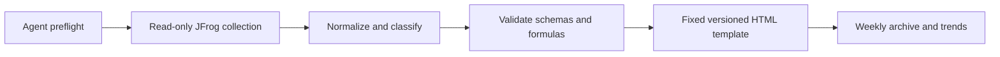

<div align="center">

# JFrog Platform Report Skill

### Fresh JFrog evidence. Clear leadership decisions.

_A portable Agent Skill for deterministic, modular Platform Value & Risk reporting._

[](SKILL.md)
[](apm.yml)
[](#development)
[](LICENSE)

</div>



The skill collects fresh, read-only evidence from the capabilities available in a
customer's JFrog environment and turns it into a self-contained weekly HTML report.
Every metric is classified as **observed**, **derived**, **projected**, **benchmark**,
or **unavailable**. Missing evidence is never silently converted to zero.

> This is not an official JFrog publication. Reports are generated using JFrog
> Platform Skills from evidence visible to the configured customer identity.

## Quick start

### APM — reproducible project installation

```bash
mkdir -p ~/jfrog-platform-reporting
cd ~/jfrog-platform-reporting
apm init -y

apm install liquid-jedi/jfrog-platform-report-skills#v1.2.0 \
  --target claude,cursor,codex,gemini
```

### Global Agent Skills installation

```bash
npx skills add git@github.com:liquid-jedi/jfrog-platform-report-skills.git \
  -g --skill jfrog-platform-report
```

Then ask your agent:

```text
Generate weekly platform report
```

The skill discovers the default JFrog CLI instance, resolves the last completed ISO
week, presents one compact confirmation, collects fresh evidence and saves the report
under the configured per-instance archive.

[Installation details](docs/INSTALL.md) · [Troubleshooting](docs/TROUBLESHOOTING.md)

## One report, modular views

| Component | Leadership question |
|---|---|
| **Executive overview** | What changed, what matters and what needs attention? |
| **Trends** | Is adoption, value or risk improving week over week? |
| **Curation** | What was evaluated, allowed or stopped before consumption? |
| **Artifactory** | What is stored, how is the repository estate distributed and how is traffic changing? |
| **Xray** | What security and license findings were created during the period? |
| **AI security** | Which models, MCP servers, skills and plugins are governed, scanned or risky? |
| **Access & OIDC** | Which tokens need rotation and where is workload identity trusted? |
| **JAS & Runtime** | Which findings are applicable, exploitable or present in production? |
| **Economic context** | What external benchmark or approved customer scenario is defensible? |
| **Recommendations** | Which actions need an owner in the next 7 or 30 days? |

Artifactory-only, Artifactory + Xray and full-platform environments are supported.
Optional products are feature-detected; an unavailable capability does not break the
report or masquerade as a genuine zero.

## Deterministic by design



- The agent orchestrates; scripts collect, normalize, calculate and render.
- Raw responses are checksum-manifested with source, period and collection time.
- Incomplete pagination fails the run instead of publishing partial totals.
- Current posture and period activity remain separate.
- Prior reports are used only after current collection, and only for labelled trends.
- A failed rerun never replaces the last validated report.

## Truthful economics

Without an approved per-instance economic profile, the bundled Forrester TEI composite
is shown strictly as external **benchmark** context—not customer ROI. An explicitly
approved profile can enable deterministic conservative, expected and optimistic
customer projections with configurable currency, costs, coverage and realization.

Each report preserves the exact profile snapshot used. Duplicate benefits, invalid
assumptions and missing FX evidence are rejected rather than estimated by the agent.

[Economic profile contract](references/economic-profiles.md)

## Evidence and safety

| Guarantee | Behavior |
|---|---|
| Read-only by default | Publication or platform mutation requires explicit authorization |
| No invented values | Missing, forbidden, unlicensed, partial and zero remain distinct |
| No backdating | Current AI, Artifactory or access posture is never represented as historical activity |
| No double counting | Every projected benefit has one unique benefit key |
| Privacy-aware access reporting | Token secrets, IDs and scopes are never written to the report |
| Portable output | The report is a self-contained HTML file with its font and assets embedded |

## Output archive

```text
<report-root>/<instance>/weekly/<week-ending>/
├── report.html
├── data.json
├── latest.json
└── runs/<UTC-run-id>/
    ├── report.html
    ├── data.json
    ├── evidence.json
    ├── economic-profile.snapshot.json
    ├── collection-diagnostics.json
    └── raw/
```

The default promoted report is:

```text
~/jfrog-platform-reports/<instance>/weekly/<week-ending>/report.html
```

## Custom rendering

Section selection changes presentation, not collection or calculation semantics.

```bash
python3 scripts/list_report_sections.py

python3 scripts/render_report.py \
  --data /path/to/data.json \
  --template assets/dashboard.html \
  --output /path/to/report.html \
  --modules executive,trend,artifactory,ai-security,recommendations,evidence
```

## Development

The test suite uses fixtures and does not require a production JFrog environment.

```bash
git clone https://github.com/liquid-jedi/jfrog-platform-report-skills.git
cd jfrog-platform-report-skills
python3 -m unittest discover -s tests -v
```

| Resource | Purpose |
|---|---|
| [Skill workflow](SKILL.md) | Agent orchestration, safety and reporting contract |
| [Architecture](references/architecture.md) | Deterministic workflow and extension boundaries |
| [Data-source matrix](references/data-source-matrix.md) | Supported evidence and known product-data gaps |
| [Metric contract](references/metric-contract.md) | Classification, formulas and financial rules |
| [Product modules](references/product-modules.md) | Module ownership and interpretation |
| [Installation](docs/INSTALL.md) | APM, global installation and updates |
| [Troubleshooting](docs/TROUBLESHOOTING.md) | Common installation and collection issues |

---

<div align="center">

Built for Claude, Claude Code, Cursor, Codex, ChatGPT, Gemini and other Agent Skills hosts.

**Author:** Avinash Giri · **License:** [Apache 2.0](LICENSE)

Report typography uses [Open Sans](assets/OFL-OpenSans.txt), distributed under the SIL Open Font License.

</div>
